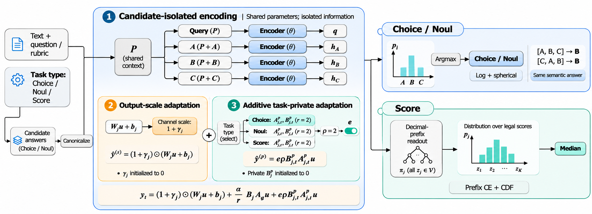

# DeciForm

DeciForm provides structured decision models for **Choice**, **Noul** (Boolean decisions), and **Score** (numerical ratings). The public implementation supports **Qwen3.5** and **ModernBERT** through a common data, training, prediction, and evaluation interface.

The model combines candidate-isolated encoding, shared-input adapters, output-scale parameters, and optional private adaptation conditioned on the explicitly supplied task type. Choice and Noul use log+spherical supervision; Score uses a decimal-prefix readout with CE and ordinal CDF supervision.

*DeciForm architecture overview. The additive private-residual formulation shown uses the Qwen configuration; backbone-specific details are described in [Model components](docs/public/model.md).*

## Installation

Use Python 3.10 or newer and a PyTorch build matching your CUDA installation:

~~~bash
python -m pip install -e '.[test,data]'
python -m deciform.core --help
python -m pytest -q tests/public
~~~

The verified environment is recorded in [requirements-tested.txt](requirements-tested.txt). Model code is sensitive to Transformers backbone internals; use that pinned environment when reproducing runs. The GPU smoke checks cover PyTorch 2.11.0 and Transformers 5.20.2. Optional accelerated Qwen kernels are not bundled.

## Tasks and inputs

Every request supplies a task type, text, and instructions. Choice supplies candidate descriptions and optional stable identities. Score supplies the complete legal numerical support or a range with an explicit step.

~~~json
{
  "id": "example-1",
  "task": "choice",
  "state": "The parcel arrived with a broken screen.",
  "question": {
    "instructions": "Select the complaint category.",
    "options": ["Damaged product", "Late delivery", "Billing issue"],
    "option_ids": ["damage", "delay", "billing"]
  }
}
~~~

Predictions contain candidate identities, aligned probabilities, the selected identity, and its input index. Score additionally returns the expected score; the default decision is the distribution median. Labels are required for training and are excluded from model encodings. See [task examples](examples/public/requests.jsonl) and [data schema](docs/public/data.md).

## Prepare data

The example records are synthetic format examples. Replace them with your own normalized JSONL before training a model.

~~~bash
python -m deciform.core validate examples/public/train.jsonl --require-label
python -m deciform.core prepare \
  --train examples/public/train.jsonl \
  --output data/example_release --negative-count 3 --views 1
python -m deciform.core verify data/example_release/manifest.json
~~~

Pass --dev and --test to preserve held-out splits. Preparation records hashes and counts, rejects exact cross-split input overlap and declared group overlap, and freezes a separate training-candidate file. Evaluation always retains every supplied native candidate. Text is never silently truncated.

--views 2 forms a **Union** of up to two disjoint sets of sampled negatives, with one positive set and one loss per original question. This option affects Choice training only. Noul and Score retain their complete supports.

Raw JSONL, CSV/TSV, and Parquet conversion, pinned Hugging Face downloads, and MIND TSV conversion are documented in [data preparation](docs/public/data.md). Historical 100k/200k population counts and hashes are in [provenance/data](provenance/data); rebuilding those exact populations is distinct from preparing custom input files.

## Train

Choose [Qwen](configs/public/qwen.json) or [ModernBERT](configs/public/modernbert.json). The configuration declares the base model explicitly. Qwen freezes its backbone and trains adaptation/readout modules. ModernBERT jointly trains its backbone and adaptation/readout modules.

~~~bash
CUDA_VISIBLE_DEVICES=0,1,2,3 torchrun --standalone --nproc_per_node=4 \
  -m deciform.core train \
  --model-config configs/public/modernbert.json \
  --train-config configs/public/training.json \
  --data data/my_release/train.views.jsonl \
  --output runs/my_deciform
~~~

For Qwen, change the model configuration to configs/public/qwen.json. A local model directory can replace base_model. Set revision to a specific model revision when downloading from a hub. The supplied training defaults use one epoch and a global batch of 64. Adjust micro_batch to available memory; full-candidate evaluation can require substantially more memory than sampled training.

Fresh training starts from the declared backbone. --resume restores optimizer, scheduler, data position, and per-process RNG state. --initialize-from explicitly starts a new training schedule from an exported DeciForm model. See [training and checkpoints](docs/public/training.md).

## Predict and evaluate

~~~bash
python -m deciform.core predict \
  --checkpoint runs/my_deciform/checkpoint \
  --input data/my_release/test.jsonl \
  --output runs/my_deciform/test.predictions.jsonl --device cuda

python -m deciform.core evaluate \
  --data data/my_release/test.jsonl \
  --predictions runs/my_deciform/test.predictions.jsonl \
  --output runs/my_deciform/test.metrics.json
~~~

The evaluator checks record identity, candidate coverage, and probability validity. Metrics are accuracy for single-label Choice/Noul, MAE for Score, and impression-averaged AUC/MRR/nDCG for multi-positive ranking. [Permutation auditing](docs/public/evaluation.md) compares outputs by candidate identity after changing input order.

## Repository guide

| Path | Purpose |
|---|---|
| src/deciform/core/ | Portable public implementation and CLI |
| configs/public/ | Backbone, optimization, and population definitions |
| examples/public/ | Synthetic request and raw-source examples |
| tests/public/ | CPU model, data, objective, and checkpoint tests |
| docs/public/ | Input contracts, mechanisms, training, evaluation, release status |
| provenance/ | Component origins and historical data hashes |

[Architecture](docs/public/model.md) explains backbone-specific adaptation. [Release status](docs/public/release.md) distinguishes implemented public interfaces from remaining reproduction packaging. Superseded interfaces, configurations and v0.1 weights have been removed from the active tree and retained in a local, Git-ignored recovery archive. The public package contains only the current implementation.

## License and attribution

Project code uses Apache-2.0. The Kev compatibility utilities retain their upstream Apache-2.0 notice and license; see [THIRD_PARTY_NOTICES.md](THIRD_PARTY_NOTICES.md). Pretrained models and datasets retain their respective upstream terms. Raw datasets and backbone weights are not included in the public source export.
